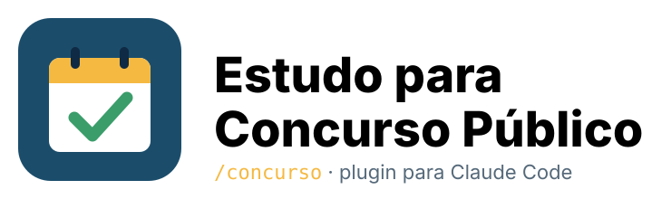
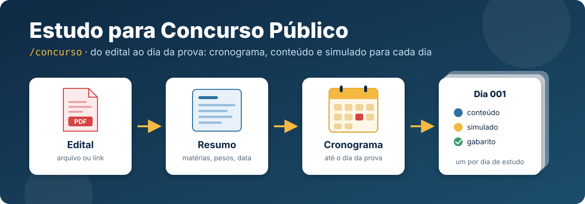

<p align="center">
  
</p>

> Passe o edital, receba o plano de estudo inteiro até o dia da prova.
> Para cada dia: o que estudar, o material reunido da web e um simulado
> no estilo da banca, com gabarito comentado.
> E, antes disso, um aviso no celular quando abrir um concurso que combina com você.

[](docs/superpowers/specs/2026-11-23-concurso-skill-design.md)
[](https://claude.com/claude-code)
[](#)

## Por que usar

O edital tem 80 páginas, a prova é daqui a três meses e a primeira semana vai embora montando planilha. Esta skill faz esse trabalho por você.

- **Lê o edital por você.** O PDF, local ou por link, vira um resumo com o que importa: cargo, banca, data, matérias com número de questões e peso, conteúdo programático e as regras que mudam a estratégia, como a errada que anula a certa no Cebraspe.

- **Monta um cronograma que respeita o peso.** Todos os dias, de amanhã até a véspera da prova, são distribuídos na proporção de `questões × peso`. São duas matérias por dia, intercaladas, com revisão a cada sete dias e uma reserva final de revisão geral. Se faltar tempo, a skill avisa em vez de esconder.

- **Junta o conteúdo de cada dia.** Lei seca do Planalto, súmulas e jurisprudência do STF e do STJ, e materiais abertos, organizados por tópico do edital e sempre com o link da fonte.

- **Entrega um simulado por dia.** Questões no formato da banca: certo/errado no Cebraspe e cinco alternativas na FGV, FCC e Vunesp. O simulado cobra só o que você estudou naquele dia, e o gabarito comenta cada questão, citando o artigo.

- **Tudo em arquivos simples.** Uma pasta por concurso, uma pasta por dia, material de estudo em PDF. Abra em qualquer leitor ou imprima. Nada fica preso dentro do chat.

- **Avisa quando abre um concurso para você.** O `/notifica-concurso` lê seu LinkedIn, site ou currículo, aponta os cargos compatíveis com a sua formação e manda um push no celular (app ntfy) sempre que sair um edital que bate com seu perfil. A verificação roda duas vezes por dia, no GitHub Actions ou no seu computador.

- **É honesta sobre os limites.** Conteúdo sem fonte web leva um aviso no topo. A data de geração fica registrada, porque a lei muda. Antes de começar, a skill mostra quantos dias vai gerar.

## Como funciona

<p align="center">
  
</p>

A skill confirma com você duas vezes, porque um erro nessas etapas contamina todo o resto:

1. **Depois de ler o edital:** você confere as matérias, os pesos e a data. Se o edital tiver vários cargos, ela pergunta qual é o seu.
2. **Depois de montar o cronograma:** você vê o total de dias e a distribuição por matéria.

A partir daí, vários agentes trabalham em paralelo, cada um com um bloco de 7 dias, e geram todo o material. Os dias de revisão saem por último, a partir do conteúdo que já foi gerado.

O design completo está em [`docs/superpowers/specs/2026-11-23-concurso-skill-design.md`](docs/superpowers/specs/2026-11-23-concurso-skill-design.md).

## Início rápido

Instale o plugin no Claude Code:

```bash
claude plugin marketplace add guglieelmor/estudo-concurso
claude plugin install concurso@estudo-concurso
```

### Mantenha a skill sempre atualizada

O Claude Code só atualiza sozinho os marketplaces oficiais da Anthropic. Para marketplaces de terceiros, como este, o auto-update vem desligado. Ative uma vez:

1. No Claude Code, rode `/plugin`.
2. Abra a aba **Marketplaces** e selecione `estudo-concurso`.
3. Escolha **Enable auto-update**.

A partir daí, o Claude Code busca a versão nova ao iniciar e avisa quando houver atualização. Reinicie a sessão para carregá-la.

Para atualizar na mão, a qualquer momento:

```bash
claude plugin marketplace update estudo-concurso
claude plugin update concurso@estudo-concurso
```

Na pasta onde quer guardar seus estudos, rode a skill com o edital:

```
/concurso ~/Downloads/edital-inss-2026.pdf
/concurso https://cdn.cebraspe.org.br/concursos/inss_26/arquivos/ED_1.PDF
```

Para ser avisado de concursos abertos que combinam com você, rode com seu perfil:

```
/notifica-concurso https://www.linkedin.com/in/seu-perfil
/notifica-concurso ~/Documentos/curriculo.pdf
```

O LinkedIn costuma bloquear a leitura sem login. Nesse caso a skill pede o PDF do perfil (no LinkedIn: **Mais** → **Salvar em PDF**). Você precisa do app **ntfy** no celular e, para rodar com o PC desligado, de uma conta no GitHub com o `gh` instalado.

O único requisito é o Claude Code. O download por link usa o `curl` do sistema. Os PDFs são gerados com Chrome, Chromium, Edge ou Brave em modo headless, então um deles precisa estar instalado.

## O que é gerado

```
INSS 2026 - Técnico do Seguro Social (Cebraspe)/
├── LEIA-ME.pdf       # cartão do concurso: cargo, banca, data, vagas, salário, avisos
├── edital.pdf        # o edital original
├── edital-resumido.pdf  # resumo do edital em PDF
├── cronograma.pdf    # tabela dia a dia
├── agentes/          # markdown que os agentes leem (fonte dos PDFs acima)
└── meus-estudos/
    ├── Dia 001 - (24-11-2026) - Direito Constitucional/
    │   ├── conteudo.pdf
    │   ├── simulado.pdf
    │   └── gabarito.pdf
    ├── Dia 002 - (25-11-2026) - Português + Raciocínio Lógico/
    ├── ...
    ├── Dia 007 - (30-11-2026) - Revisão/
    ├── ...
    └── Dia 090 - (21-02-2027) - Revisão Final/
```

| Arquivo | O que tem |
| --- | --- |
| `LEIA-ME.pdf` | Identificação do concurso, origem do edital, data de geração, tópicos sem fonte web |
| `edital-resumido.pdf` | Estrutura da prova, conteúdo programático com códigos (`DC-01`, `PT-03`…), pegadinhas do edital |
| `cronograma.pdf` | Dia, data, tipo (conteúdo, revisão, revisão final), matérias e tópicos |
| `conteudo.pdf` | Resumo, artigos de lei, o que a banca cobra, pegadinhas e fontes com link |
| `simulado.pdf` | 10 a 20 questões no formato da banca, só sobre o conteúdo do dia |
| `gabarito.pdf` | Resposta e comentário de cada questão, com a fonte |

Para o dia a dia: abra a pasta do dia, estude o `conteudo.pdf`, resolva o `simulado.pdf` e só então confira o `gabarito.pdf`.

## Bancas suportadas

| Banca | Formato do simulado |
| --- | --- |
| Cebraspe | Certo / errado |
| FGV | Múltipla escolha, 5 alternativas |
| FCC | Múltipla escolha, 5 alternativas |
| Vunesp | Múltipla escolha, 5 alternativas |
| Outras | Formato descrito no edital (4 ou 5 alternativas) |

## Mais de um concurso

Rode `/concurso` para cada edital. Cada concurso ganha uma pasta e um cronograma independentes:

```
Concursos/
├── INSS 2026 - Técnico do Seguro Social (Cebraspe)/
└── TRT-2 2027 - Analista Judiciário (FCC)/
```

Os cronogramas não se coordenam entre si. Se você estudar para os dois ao mesmo tempo, a divisão do tempo fica por sua conta.

## Se algo der errado no meio

Rode `/concurso` de novo apontando para a pasta do concurso. O edital não é relido, e os dias que já estão completos são pulados. Só os dias que faltam são gerados.

Quando a busca na web falha num tópico, o conteúdo é gerado mesmo assim, com o aviso `⚠ conteúdo sem fonte web, conferir lei atualizada` no topo. A lista desses tópicos fica no `LEIA-ME.pdf`.

## Aviso de concursos abertos

Rode `/notifica-concurso` com o link do seu LinkedIn, do seu site ou o caminho do seu currículo em PDF. A skill:

1. lê seu perfil e pergunta o que faltar (área, estados, salário mínimo);
2. gera `perfil-concurso.pdf` com os cargos que combinam com você, seus pontos fortes, as lacunas a estudar e os concursos abertos hoje;
3. configura o app **ntfy** no seu celular e manda um aviso de teste;
4. instala um verificador que roda às 8h e às 18h, no GitHub Actions ou no seu computador, você escolhe.

Rode `/notifica-concurso` de novo para editar o perfil ou desligar os avisos.

## Cuidados

- **Leva tempo e consome bastante uso.** Todo o material sai de uma vez. Uma prova daqui a 90 dias significa 90 pastas com busca na web.
- **A lei muda.** O conteúdo reflete a data em que foi gerado. Perto da prova, confira na fonte oficial os artigos mais cobrados.
- **PDF escaneado** (imagem, sem texto) ainda não é suportado. Nesse caso a skill avisa e para.
- **O material é um apoio.** Não substitui o edital oficial nem a leitura da lei seca.
